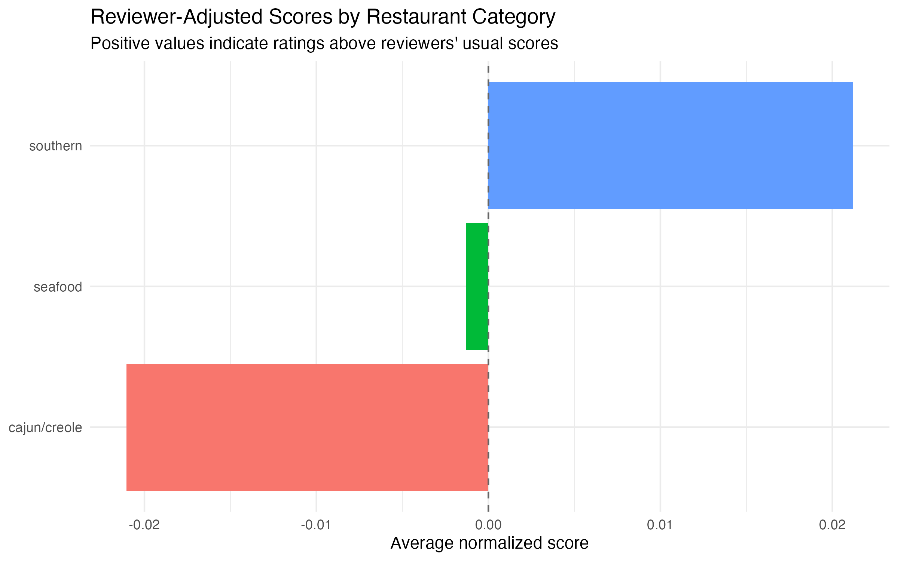
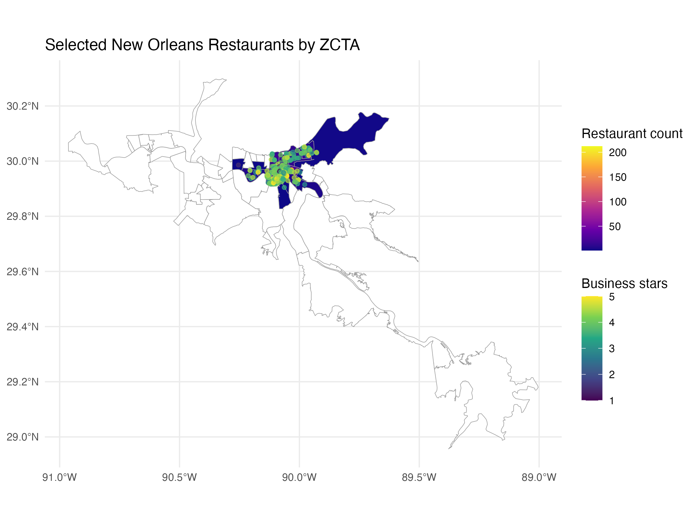
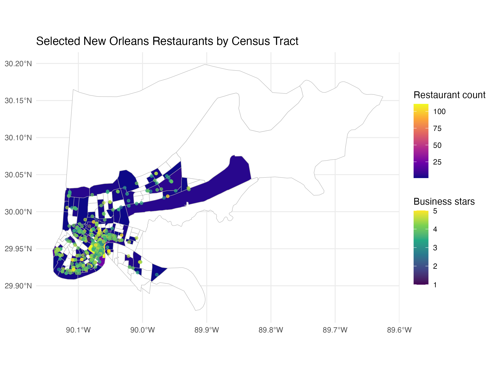
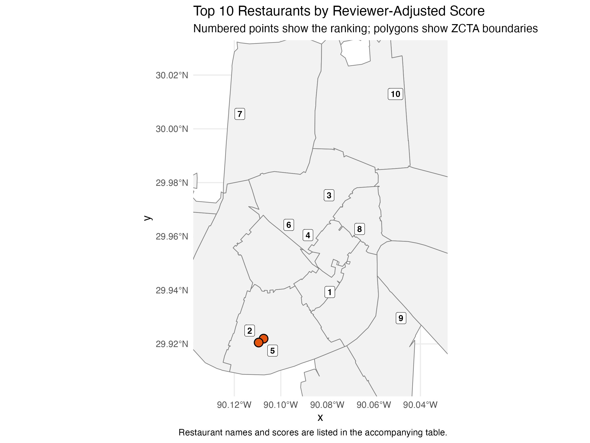
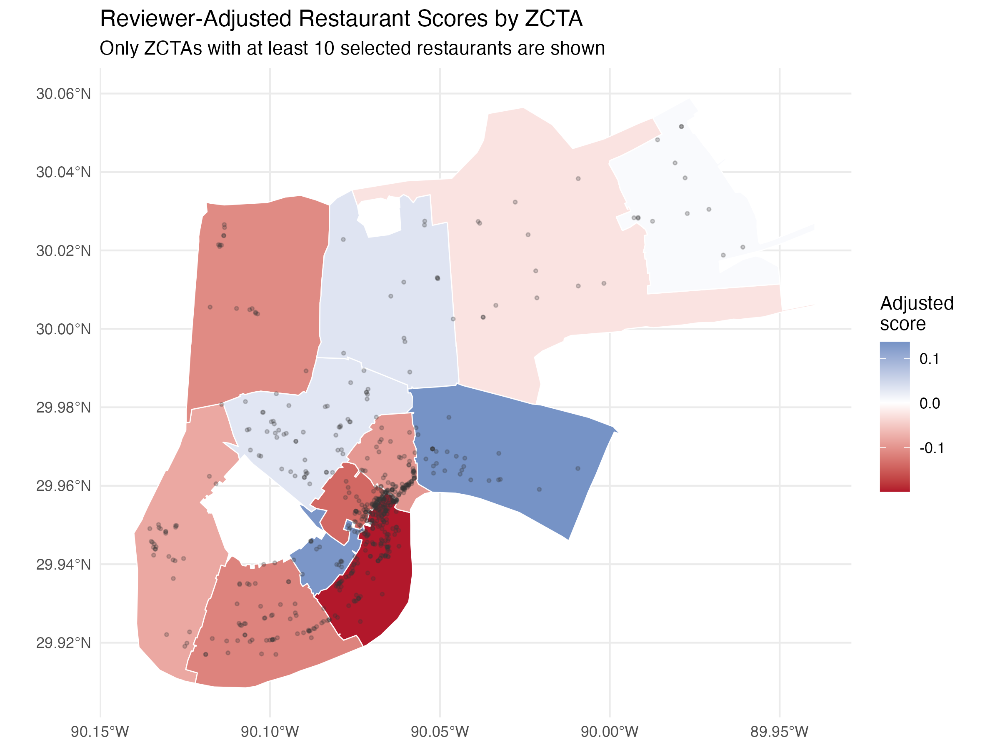

## Executive summary

This project analyzes Cajun/Creole, seafood, and Southern restaurants in the New Orleans area using Yelp business and review data. The analysis includes 648 selected restaurants and 248,426 Yelp reviews.

Southern restaurants had the highest category-level ratings after reviewer adjustment. ZCTA 70117 had the strongest reviewer-adjusted geographic results among areas with at least 10 selected restaurants. ZCTA 70130 contained the largest concentration of restaurants and reviews, but it did not have the highest ratings.

## Research question

Where can someone find the best Cajun/Creole, seafood, and Southern restaurants in New Orleans, and how does the answer change after adjusting for reviewer behavior?

## Data and large-file management

The analysis used the Yelp Open Dataset business and review files. The business file contained 150,346 businesses, and the review file contained 6,990,280 review records.

I first filtered the business data to businesses with `state = "LA"`, `city = "New Orleans"`, and a category containing “Restaurants.” This produced 2,259 Yelp-labeled New Orleans restaurants. I then selected restaurants belonging to at least one of the three categories used in this project.

The review file was too large to load into memory all at once. I processed it in pages of 5,000 records and kept only reviews connected to the 648 selected restaurants. This produced 248,426 reviews. The filtered business and review data were saved as compressed RDS files, while the raw JSON files remained local and were excluded from GitHub through `.gitignore`.

## Selected geographic region

I define the study region using Yelp businesses labeled as being in New Orleans, Louisiana. New Orleans is strongly associated with Cajun/Creole, seafood, and Southern food culture, making it a meaningful region for this analysis.

An official spatial join showed that most selected businesses were physically located inside the official New Orleans boundary.

| Dataset | Inside official New Orleans boundary | Outside boundary |
|---|---:|---:|
| All Yelp-labeled New Orleans restaurants | 2,202 | 57 |
| Selected category restaurants | 632 | 16 |

I retained the full Yelp-labeled sample because the project focuses on businesses identified by Yelp as being in the New Orleans area. The 16 businesses outside the official boundary are treated as a geographic-label limitation.

## Selected restaurant categories

I selected Cajun/Creole, seafood, and Southern restaurants because these categories are closely connected to New Orleans food culture. A restaurant was included if it belonged to at least one of these categories.

The selected dataset contains 648 unique restaurants. Because some restaurants belong to multiple categories, the category counts do not add up to 648.

| Category | Number of restaurants |
|---|---:|
| Cajun/Creole | 401 |
| Seafood | 331 |
| Southern | 155 |

The categories also overlap:

| Category pair | Restaurants in both categories |
|---|---:|
| Cajun/Creole and seafood | 156 |
| Cajun/Creole and Southern | 72 |
| Seafood and Southern | 45 |

The selected restaurants occur in 24 ZCTAs, and 12 ZCTAs contain at least 10 selected restaurants. This exceeds the project requirement of having at least 10 restaurants in at least 7 geographic areas.

## Review data

The review file contained reviews for all 648 selected restaurants.

| Measure | Result |
|---|---:|
| Review records scanned | 6,990,280 |
| Selected restaurants | 648 |
| Selected reviews | 248,426 |
| Unique review IDs | 248,426 |
| Duplicate review rows | 0 |
| Earliest review | 2005-03-14 |
| Latest review | 2022-01-19 |

All 648 selected restaurants had at least one review, and no review text was missing.

The number of reviews counted directly from the review file was slightly higher than the business-level `review_count` field. The business metadata contained 243,635 total reviews for the selected businesses, while the review file contained 248,426. The difference affected 461 businesses, with the review file containing 4,791 additional reviews. Because the review file contains the actual review records used in the analysis, I used the review-file counts for review-volume calculations.

## Reviewer-adjusted ratings

Ordinary Yelp averages treat every rating the same, even though some reviewers may regularly give very high or very low scores. To account for this, I calculated each reviewer’s average rating and subtracted that personal baseline from each review.

A normalized score above zero means that the reviewer rated the restaurant higher than usual. A score below zero means that the reviewer rated it lower than usual. The normalized score is not a replacement Yelp rating.

I used reviewers with at least five reviews in the selected restaurant group for the main reviewer-adjusted analysis.

| Minimum reviews per reviewer | Eligible reviewers | Eligible reviews | Percent of all reviews |
|---:|---:|---:|---:|
| 1 | 138,073 | 248,426 | 100.0% |
| 3 | 21,792 | 108,450 | 43.7% |
| 5 | 7,052 | 59,407 | 23.9% |
| 10 | 1,366 | 24,916 | 10.0% |

The five-review threshold provided a reasonable balance between reviewer reliability and retaining enough data. For individual restaurant rankings, I used a stricter requirement of at least 10 eligible reviews.

## Category-level results

The ordinary review results were:

| Category | Restaurants | Total reviews | Average business stars | Average review stars | Weighted average review stars | Median reviews per restaurant |
|---|---:|---:|---:|---:|---:|---:|
| Cajun/Creole | 401 | 188,043 | 3.77 | 3.79 | 3.91 | 169 |
| Seafood | 331 | 144,026 | 3.87 | 3.87 | 3.96 | 117 |
| Southern | 155 | 66,355 | 3.91 | 3.91 | 3.99 | 174 |

Because restaurants can belong to more than one category, the category totals are not additive.

The reviewer-adjusted results were:

| Category | Restaurants with eligible reviews | Eligible reviewers | Eligible reviews | Average review stars | Average normalized score | Median normalized score |
|---|---:|---:|---:|---:|---:|---:|
| Southern | 154 | 6,048 | 16,323 | 3.97 | 0.021 | 0.167 |
| Seafood | 327 | 6,973 | 32,747 | 3.95 | -0.001 | 0.152 |
| Cajun/Creole | 394 | 7,036 | 42,216 | 3.92 | -0.021 | 0.143 |

*The adjusted table includes only restaurants with at least one eligible-reviewer review, so its restaurant counts differ from the full category counts above.*

Southern restaurants had the strongest adjusted category result. Seafood was approximately neutral, while Cajun/Creole restaurants were slightly below reviewers’ usual scoring baselines.

### Reviewer-adjusted category comparison

## Geographic systems compared

I compared ZIP Code Tabulation Areas (ZCTAs) with Census tracts.

ZCTAs are easier for a general audience to understand and are useful for business-location questions. Census tracts provide more detail but create many smaller areas, including areas with very few restaurants.

| Geographic system | Number of areas | Restaurants assigned | Unmatched restaurants | Smallest area count | Largest area count |
|---|---:|---:|---:|---:|---:|
| ZCTA | 24 | 648 | 0 | 1 | 212 |
| Census tract | 108 | 632 | 16 | 1 | 111 |

## Restaurants by ZCTA

## Restaurants by Census tract

## Reviewer-adjusted restaurant rankings

I define the top 10 restaurants as restaurants with at least 10 eligible-reviewer reviews, ranked by their average reviewer-normalized score.

| Restaurant | ZIP code | All reviews | Eligible reviews | Average all-reviewer stars | Adjusted score | Raw rank | Adjusted rank |
|---|---:|---:|---:|---:|---:|---:|---:|
| Cafe Porche and Snowbar | 70113 | 176 | 11 | 4.83 | 0.759 | 2 | 1 |
| Bonafried | 70115 | 31 | 18 | 4.55 | 0.608 | 18 | 2 |
| Orchid Seafood | 70119 | 33 | 16 | 4.48 | 0.601 | 25 | 3 |
| Avery's On Tulane | 70119 | 306 | 100 | 4.64 | 0.591 | 8 | 4 |
| Tito's Ceviche & Pisco | 70115 | 221 | 94 | 4.72 | 0.589 | 6 | 5 |
| Jaidyn's Wing Stop/Food For The Soul | 70119 | 60 | 21 | 4.58 | 0.585 | 13 | 6 |
| Chap's Chicken | 70124 | 55 | 17 | 4.51 | 0.580 | 23 | 7 |
| Meauxbar | 70116 | 283 | 74 | 4.40 | 0.577 | 40 | 8 |
| Seersucker Restaurant & Catering | 70053 | 46 | 14 | 4.72 | 0.554 | 7 | 9 |
| Fiorella's the Original | 70122 | 133 | 68 | 4.44 | 0.535 | 35 | 10 |

Reviewer adjustment changed the rankings substantially. For example, Bonafried moved from rank 18 to rank 2, Orchid Seafood moved from rank 25 to rank 3, and Meauxbar moved from rank 40 to rank 8. This shows that raw Yelp averages and reviewer-adjusted results can produce different conclusions.

## Location of the top 10 restaurants

The map below shows the locations of the top 10 restaurants ranked by average reviewer-normalized score. The numbered points correspond to the ranking table above, while the background polygons show the selected ZCTA boundaries.

## Reviewer-adjusted results by ZCTA

The following table includes ZCTAs with at least 10 selected restaurants.

| ZCTA | Restaurants | Total reviews | Average review stars | Eligible restaurants | Total eligible reviews | Average adjusted score | Median adjusted score |
|---|---:|---:|---:|---:|---:|---:|---:|
| 70117 | 26 | 7,526 | 4.13 | 25 | 2,285 | 0.137 | 0.157 |
| 70113 | 19 | 4,182 | 4.07 | 18 | 1,090 | 0.132 | 0.162 |
| 70122 | 13 | 968 | 4.07 | 12 | 361 | 0.032 | 0.030 |
| 70119 | 55 | 17,583 | 3.92 | 54 | 5,447 | 0.030 | 0.058 |
| 70127 | 13 | 634 | 3.78 | 13 | 206 | 0.006 | -0.054 |
| 70126 | 12 | 394 | 3.61 | 12 | 132 | -0.025 | -0.087 |
| 70118 | 30 | 7,252 | 3.94 | 30 | 2,582 | -0.081 | -0.006 |
| 70116 | 82 | 28,282 | 3.87 | 81 | 5,869 | -0.096 | -0.053 |
| 70124 | 16 | 2,553 | 3.75 | 16 | 993 | -0.108 | -0.098 |
| 70115 | 57 | 16,743 | 3.90 | 57 | 5,660 | -0.115 | 0.023 |
| 70112 | 69 | 26,213 | 3.72 | 69 | 5,512 | -0.141 | -0.115 |
| 70130 | 212 | 133,585 | 3.70 | 210 | 28,439 | -0.199 | -0.121 |

ZCTA 70117 had the strongest reviewer-adjusted result among the larger areas, followed by 70113. In contrast, ZCTA 70130 had the largest concentration of restaurants and reviews but the lowest adjusted score among these areas.

ZCTA 70130 contained 212 of the 648 selected restaurants, or approximately 32.7% of the sample. It also contained approximately 53.8% of all selected reviews. This makes it the strongest area for restaurant variety and review volume, but not necessarily for the highest ratings.

## Geographic choice

I selected ZCTAs as the primary geographic system.

ZCTAs assigned all 648 selected restaurants to geographic areas, while Census tracts left 16 restaurants unmatched. ZCTAs also provided a more understandable comparison for a restaurant-location question. The ZCTA system contained 12 areas with at least 10 selected restaurants, which supported more stable comparisons.

Census tracts offered more geographic detail, but they created 108 areas and many areas with very few restaurants. Therefore, Census tracts were useful for showing fine-scale variation but less suitable as the main comparison system.

## Main findings

### The top restaurants are spread across several areas

The top 10 restaurants were not concentrated in one single ZCTA. Several were located in ZCTAs 70119 and 70115, while others were located in 70113, 70116, 70122, 70124, and 70053. This suggests that a person searching for the best individual restaurants should not limit themselves to the area with the most restaurants overall.

The top-10 ranking is based on reviewer-normalized scores and requires at least 10 eligible-reviewer reviews. This reduces the influence of restaurants with very small review samples.

### ZCTA 70130 offers the most selection

ZCTA 70130 contained 212 of the 648 selected restaurants, or approximately 32.7% of the sample. It also contained approximately 53.8% of all selected reviews.

This makes 70130 the strongest area for restaurant variety and review volume. However, its average reviewer-adjusted score was -0.199, so having the most restaurants does not necessarily mean having the highest ratings.

### ZCTAs 70117 and 70113 had the strongest adjusted ratings

ZCTA 70117 had the highest average reviewer-adjusted score among areas with at least 10 restaurants. It contained 26 restaurants, 7,526 reviews, and had an average adjusted score of +0.137.

ZCTA 70113 followed with 19 restaurants, 4,182 reviews, and an average adjusted score of +0.132. These areas had fewer restaurants than 70130, but their restaurants performed better relative to reviewers’ usual scoring behavior.

### Southern restaurants had a modest category advantage

Southern restaurants had the highest average normalized score at +0.021. Seafood restaurants were approximately neutral at -0.001, while Cajun/Creole restaurants had an average normalized score of -0.021.

The differences are relatively small, so Southern restaurants should be described as having a modest advantage in this sample rather than being objectively better than the other categories.

### Reviewer adjustment changed the restaurant rankings

Reviewer adjustment changed several rankings substantially. Bonafried moved from rank 18 using the ordinary average to rank 2 after adjustment. Orchid Seafood moved from rank 25 to rank 3, and Meauxbar moved from rank 40 to rank 8.

This shows that raw Yelp averages do not always produce the same conclusions as ratings that account for each reviewer’s usual scoring behavior.

## Limitations

This analysis has several limitations.

First, the dataset represents Yelp businesses and Yelp reviewers rather than every restaurant or customer in New Orleans.

Second, Yelp’s city labels do not perfectly match official geographic boundaries. Sixteen selected businesses were labeled as New Orleans by Yelp but were physically located in nearby communities.

Third, ZCTAs are Census approximations of ZIP-code areas and should not automatically be interpreted as neighborhoods.

Fourth, the restaurant categories overlap. A restaurant can be included in multiple categories, so category totals and review totals are not additive.

Fifth, reviewer-adjusted scores depend on the eligibility threshold. The primary adjusted analysis used reviewers with at least five reviews, while individual restaurant rankings required at least ten eligible reviews. Restaurants with fewer reviews may have unstable rankings.

Finally, the business-level review counts and review-file counts differed for some restaurants, likely because the Yelp files represent slightly different data snapshots. Review volume calculations therefore used the records directly counted from the review file.

## Conclusion

The best geographic area depends on what a person is looking for. ZCTA 70130 is the best area for finding the largest selection of Cajun/Creole, seafood, and Southern restaurants. However, ZCTAs 70117 and 70113 are stronger choices for finding areas with higher reviewer-adjusted ratings.

Southern restaurants had the strongest category-level result, although the difference from seafood and Cajun/Creole restaurants was modest. The reviewer-adjusted rankings also showed that some restaurants changed position substantially when reviewer behavior was considered.

I selected ZCTAs as the primary geographic system because they assigned all 648 selected restaurants to areas, were easier to interpret than Census tracts, and provided 12 areas with at least 10 restaurants. Overall, the analysis suggests that restaurant recommendations should consider ratings, review volume, geographic concentration, reviewer behavior, and sample size together rather than relying on one Yelp star average.

## AI assistance and iterative prompt examples

I used an AI assistant as a coding tutor and debugging aid. I ran the code myself in R, checked the outputs, and reprompted when the first version needed improvement.

### Example 1: Improving the top-10 map

After creating the top-10 restaurant map, I noticed that two restaurant labels overlapped and were difficult to read. I prompted the assistant to revise the visualization while preserving the actual restaurant coordinates.

I then refined the request by asking for clearer point styling, removal of an unnecessary color legend, and a closer map view. The final version used numbered labels, clearer points, separated overlapping labels, and ZCTA boundaries.

### Example 2: Adding a data visualization

While reviewing the report, I recognized that the existing maps and tables did not fully communicate the differences among the three restaurant categories. I prompted the assistant to recommend an additional visualization that would complement the geographic analysis.

I then refined the request by specifying that the visualization should compare reviewer-adjusted category scores, use clear labels, and fit the report’s existing visual style. This resulted in a bar chart comparing Southern, seafood, and Cajun/Creole restaurants. The chart made the category-level differences easier to interpret and strengthened the overall presentation of the analysis.

## Source files

The analysis code and saved outputs are included in the repository.

- `R/reviews_import.R`
- `R/geographic_analysis.R`
- `data/new_orleans/business_new_orleans.rds`
- `data/new_orleans/reviews_selected.rds`
- `data/new_orleans/business_review_analysis.rds`
- `figures/selected_restaurants_by_zcta.png`
- `figures/selected_restaurants_by_tract.png`
- `figures/category_adjusted_scores.png`
- `figures/top10_restaurants_by_zcta.png`
- `figures/zcta_reviewer_adjusted_scores.png`