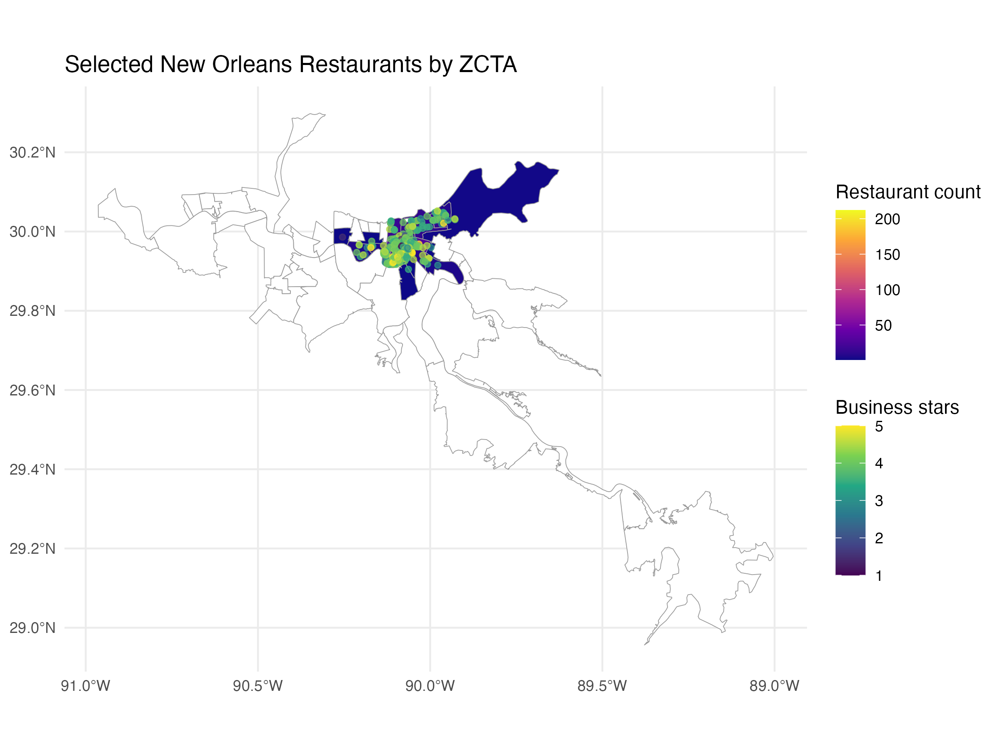
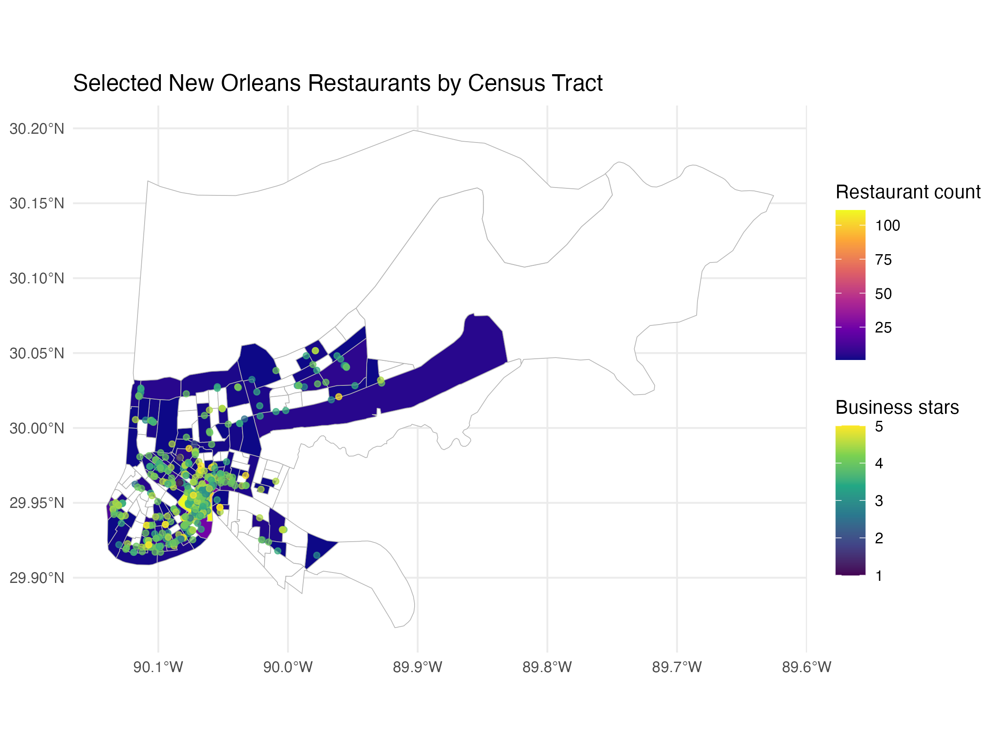

## Research question

Which geographic system provides the most useful way to compare Cajun/Creole, seafood, and Southern restaurants in New Orleans?

## Selected restaurant categories

I selected Cajun/Creole, seafood, and Southern restaurants because these categories are connected to New Orleans food culture. A restaurant was included if it belonged to at least one of these categories.

The selected dataset contains 648 unique restaurants. Because some restaurants belong to multiple categories, the category counts below do not add up to 648.

| Category | Number of restaurants |
|---|---:|
| Cajun/Creole | 401 |
| Seafood | 331 |
| Southern | 155 |

## Geographic systems compared

I compared ZIP Code Tabulation Areas (ZCTAs) with Census tracts. ZCTAs are easier for a general audience to understand and are useful for business-location questions. Census tracts provide more detail but create many smaller areas with fewer restaurants.

| Geographic system | Number of areas | Restaurants assigned | Unmatched restaurants | Smallest area count | Largest area count |
|---|---:|---:|---:|---:|---:|
| ZCTA | 24 | 648 | 0 | 1 | 212 |
| Census tract | 108 | 632 | 16 | 1 | 111 |

## Restaurants by ZCTA

## Restaurants by Census tract

## Geographic choice

I selected ZCTAs as the primary geographic system. The ZCTA analysis assigned all 648 selected restaurants to 24 areas. Census tracts assigned 632 restaurants to 108 areas, leaving 16 restaurants unmatched.

ZCTAs are easier to interpret and provide more stable comparisons for this restaurant-location question. Census tracts are more detailed, but their smaller areas and unmatched locations make them less suitable for the main comparison.

## Limitations

This analysis uses Yelp business locations and business star ratings. ZCTAs are approximations of ZIP-code areas and should not automatically be treated as neighborhoods. The results describe Yelp businesses included in this dataset and may not represent every restaurant in New Orleans.

The review-level analysis will be completed in a later project step.